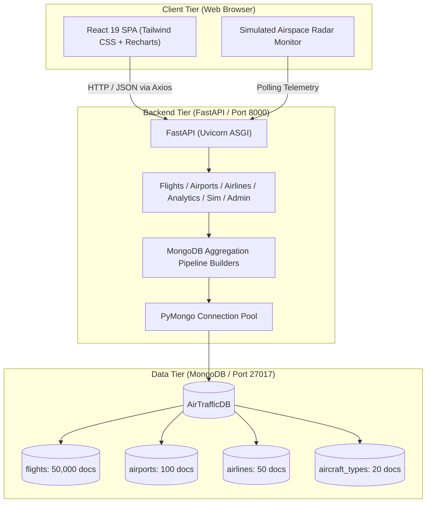

# AirTrack — Air Traffic Data Management and Analytics Using MongoDB

[](https://www.mongodb.com/)
[](https://fastapi.tiangolo.com/)
[](https://react.dev/)
[-brightgreen?logo=pytest&logoColor=white)](https://docs.pytest.org/)
[](data/README.md)

> **ACADEMIC DEMONSTRATION NOTICE**:  
> AirTrack is an academic demonstration developed for Big Data Analytics and database engineering coursework using a reproducible synthetic aviation dataset. It is **NOT** an operational Air Traffic Control (ATC) system, does not connect to live radar feeds, and must not be used for actual aircraft navigation.

---

## 1. Project Overview

**AirTrack** is a full-stack Big Data Analytics platform engineered to demonstrate how NoSQL document-oriented databases (MongoDB) store, manage, query, and aggregate large volumes of structured and semi-structured commercial aviation data.

The system indexes **50,000 synthetic flight records**, **100 international airports**, **50 airlines**, and **20 aircraft types** inside the MongoDB database **`AirTrafficDB`**.

### Key System Capabilities
- **Executive Analytics Dashboard**: Real-time KPI summaries, flight status distribution (donut chart), monthly operations volume & delay trend (composed chart), and causality bar breakdown.
- **Simulated Airspace Radar Scope**: Interactive 360° radar sweep display plotting active en-route flights with simulated coordinates, altitudes, groundspeeds, and headings.
- **Flight Operations Manager (CRUD)**: Paginated data table implementing modern web responsive table best practices, with multi-parameter filtering, search, and full Create, Read, Update, and Delete capabilities.
- **Aviation Big Data Analytics Hub**:
  - **Delay Diagnostics**: Diurnal 24-hour delay curve, day-of-week trends, and top 10 worst delayed flight corridors.
  - **Airport Traffic**: Top 10 busiest airports with departures vs. arrivals stacked comparison, and popular flight corridors.
  - **Airline Performance Benchmarking**: 50 airlines ranking table sortable by on-time percentage, delay, and flight volume.
  - **MongoDB Aggregation Playground**: Transparent inspection of the underlying MongoDB aggregation pipelines.
- **Airports & Airlines Directories**: Interactive visual directories with detailed traffic and performance modals.
- **Database & System Diagnostics**: Live MongoDB connection monitor, collection statistics, and MongoDB Compass inspection guide.

---

## 2. Technology Stack

| Layer | Technology | Role & Version |
| :--- | :--- | :--- |
| **Database** | MongoDB Community Server | Document store on port 27017 (`AirTrafficDB`), B-Tree, compound, text & 2dsphere indexes |
| **Backend** | Python 3.13 / FastAPI | Asynchronous REST API framework (ASGI via Uvicorn) |
| **Driver / ODM** | PyMongo 4.x / Pydantic v2 | Connection pooling, aggregation pipeline execution, and schema validation |
| **Frontend** | React 19 / TypeScript 5.8 | Modern component-driven Single Page Application |
| **Build Tool** | Vite 8.x | High-speed bundler with backend proxy configuration |
| **Styling** | Tailwind CSS 3.4 | Custom aviation dark theme (`aviation-950`, `aviation-900`, `sky`, `radar`) |
| **Charts** | Recharts 2.x | Composed, Pie, Bar, Line, and Radar charts |
| **Testing** | Pytest 9.x / TestClient | Automated backend test suite (18 unit and integration tests) |

---

## 3. High-Level System Architecture



---

## 4. Quick Start & Execution Guide

### Prerequisites
1. **Python 3.11+** installed (`python --version`)
2. **Node.js 18+** & **npm** installed (`node --version`)
3. **MongoDB Community Server** installed and running on `localhost:27017` (verified running as Windows Service `MongoDB`)

---

### Step 1: Set Up Backend Virtual Environment
```powershell
# In project root:
cd c:\Users\aishh\OneDrive\Desktop\Projects\AirTrack

# Create and activate Python virtual environment
python -m venv backend/venv
.\backend\venv\Scripts\Activate.ps1

# Upgrade pip and install dependencies
pip install -r backend/requirements.txt
```

---

### Step 2: Generate Synthetic Corpus & Seed MongoDB
AirTrack includes a deterministic synthetic data generator using random seed `42`:
```powershell
# 1. Generate 50,000 flights, 100 airports, 50 airlines, 20 aircraft
python data/scripts/generate_data.py

# 2. Seed MongoDB database AirTrafficDB (creates compound, text & 2dsphere indexes)
python data/scripts/seed_mongodb.py
```
*Seeding 50,000 documents and creating all indexes takes approximately 5–6 seconds.*

---

### Step 3: Start the FastAPI Backend
```powershell
# Activate venv if not already active
.\backend\venv\Scripts\Activate.ps1

# Start Uvicorn server
uvicorn app.main:app --app-dir backend --host 127.0.0.1 --port 8000 --reload
```
- API Base URL: `http://localhost:8000/`
- Interactive OpenAPI Docs (Swagger UI): `http://localhost:8000/docs`
- Database Health Endpoint: `http://localhost:8000/health`

---

### Step 4: Start the React Frontend
In a new terminal window:
```powershell
cd c:\Users\aishh\OneDrive\Desktop\Projects\AirTrack\frontend

# Install dependencies (if first time)
npm install

# Start Vite development server
npm run dev
```
Open your browser and navigate to:
**`http://localhost:5173/`**

---

## 5. Running Automated Tests

Run the comprehensive 18-test Pytest suite:
```powershell
$env:PYTHONPATH="backend"
.\backend\venv\Scripts\python -m pytest backend/tests/ -v
```
To verify the frontend build:
```powershell
cd frontend
npm run build
```

---

## 6. Inspecting the Database in MongoDB Compass

1. Launch **MongoDB Compass**.
2. Connect to `mongodb://localhost:27017`.
3. In the left panel, select the **`AirTrafficDB`** database.
4. Inspect the 4 collections:
   - **`flights`** (50,000 documents): Check the **Indexes** tab to verify compound indexes on `{ status: 1, scheduled_departure: -1 }` and `{ "origin_airport.iata_code": 1, "destination_airport.iata_code": 1 }`.
   - **`airports`** (100 documents): Inspect the **`2dsphere`** geospatial index on GeoJSON `coordinates`.
   - **`airlines`** (50 documents): Inspect the text index on `name` and `country`.
   - **`aircraft_types`** (20 documents).

---

## 7. Project Documentation Manifest
- [`documentation/project_overview.md`](documentation/project_overview.md): Project identification, scope, and objectives.
- [`documentation/system_architecture.md`](documentation/system_architecture.md): 3-tier architecture, data flow, and component breakdown.
- [`documentation/database_design.md`](documentation/database_design.md): MongoDB document schemas, indexing justifications, and ER diagrams.
- [`documentation/implementation.md`](documentation/implementation.md): Implementation details, aggregation pipelines, and run instructions.
- [`documentation/testing.md`](documentation/testing.md): Automated Pytest results and manual test cases matrix.
- [`outputs/dataset_verification.json`](outputs/dataset_verification.json): Verification audit confirming 50,000 flights, 100 airports, 50 airlines, and 20 aircraft loaded into MongoDB.
