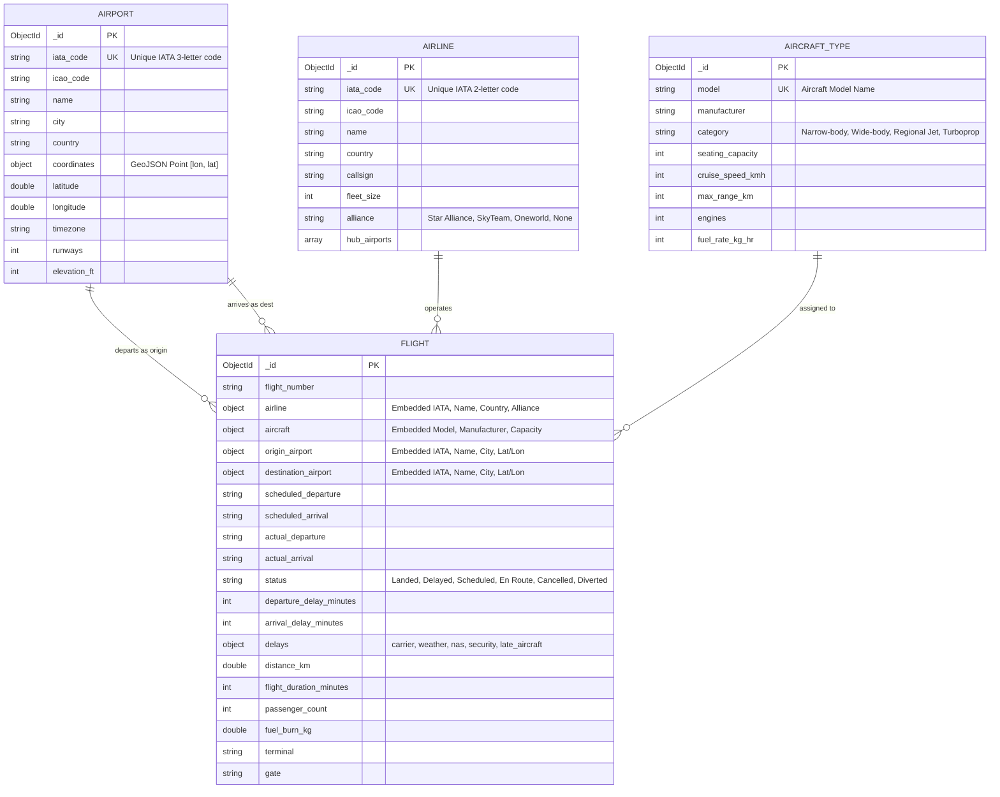

# AirTrack — Database Design & MongoDB Schema

## 1. Database Identification & Technology
- **Database Engine**: MongoDB Community Server 7.x / 8.x
- **Database Name**: `AirTrafficDB`
- **Default Connection URI**: `mongodb://localhost:27017`
- **Client Driver**: PyMongo 4.x (Python)

---

## 2. Document Data Modeling Philosophy
In commercial aviation data management, flight operations systems handle millions of time-sensitive queries requiring instant lookups of flight state, airline identity, departure/arrival airports, and delay attribution. 

In a traditional relational database (RDBMS), rendering a single flight status board requires 4-way joins between `flights`, `airlines`, `airports` (twice for origin and destination), and `aircraft`.

In **MongoDB**, AirTrack adopts a **hybrid denormalization pattern**:
- **Critical read-frequently attributes** (e.g., airline name and IATA code, origin airport city and coordinates, aircraft model) are **embedded directly** within each flight document.
- **Reference collections** (`airports`, `airlines`, `aircraft_types`) maintain authoritative directory master records, runway configurations, and fleet rosters.
- **Result**: Zero runtime joins are needed to query or aggregate 50,000 flights, achieving sub-10ms query latency.

---

## 3. Entity-Relationship & Document Schema



---

## 4. Collection Schemas in Detail

### 4.1 Collection: `flights` (50,000 Documents)
```json
{
  "_id": {"$oid": "67201a09d3b84f32e49c71a1"},
  "flight_number": "AA1204",
  "airline": {
    "iata_code": "AA",
    "name": "American Airlines",
    "country": "United States",
    "alliance": "Oneworld"
  },
  "aircraft": {
    "model": "Boeing 737-800",
    "manufacturer": "Boeing",
    "category": "Narrow-body",
    "capacity": 189
  },
  "origin_airport": {
    "iata_code": "DFW",
    "name": "Dallas/Fort Worth International Airport",
    "city": "Dallas",
    "country": "United States",
    "latitude": 32.8998,
    "longitude": -97.0403,
    "timezone": "America/Chicago"
  },
  "destination_airport": {
    "iata_code": "ORD",
    "name": "O'Hare International Airport",
    "city": "Chicago",
    "country": "United States",
    "latitude": 41.9742,
    "longitude": -87.9073,
    "timezone": "America/Chicago"
  },
  "scheduled_departure": "2026-08-14T08:30:00+00:00",
  "scheduled_arrival": "2026-08-14T10:45:00+00:00",
  "actual_departure": "2026-08-14T08:58:00+00:00",
  "actual_arrival": "2026-08-14T11:13:00+00:00",
  "status": "Delayed",
  "departure_delay_minutes": 28,
  "arrival_delay_minutes": 28,
  "delays": {
    "carrier_delay": 18,
    "weather_delay": 0,
    "nas_delay": 10,
    "security_delay": 0,
    "late_aircraft_delay": 0
  },
  "distance_km": 1290.4,
  "flight_duration_minutes": 135,
  "passenger_count": 168,
  "fuel_burn_kg": 5625.0,
  "terminal": "T3",
  "gate": "C14"
}
```

### 4.2 Collection: `airports` (100 Documents)
```json
{
  "_id": {"$oid": "67201a09d3b84f32e49c7001"},
  "iata_code": "JFK",
  "icao_code": "KJFK",
  "name": "John F. Kennedy International Airport",
  "city": "New York",
  "country": "United States",
  "coordinates": {
    "type": "Point",
    "coordinates": [-73.7781, 40.6413]
  },
  "latitude": 40.6413,
  "longitude": -73.7781,
  "timezone": "America/New_York",
  "runways": 4,
  "elevation_ft": 13
}
```

---

## 5. Indexing Strategy & Performance Justification

To ensure high-speed querying and real-time analytical pipeline execution over 50,000 documents, the following indexes are maintained in MongoDB:

| Collection | Index Key | Index Type | Optimization Target |
| :--- | :--- | :--- | :--- |
| `flights` | `{ flight_number: 1 }` | Single-field B-Tree | Instant flight lookup by callsign |
| `flights` | `{ status: 1, scheduled_departure: -1 }` | Compound B-Tree | Filtered status sorting & dashboard live query |
| `flights` | `{ "airline.iata_code": 1 }` | Single-field | Filtering by operating carrier |
| `flights` | `{ "origin_airport.iata_code": 1, "destination_airport.iata_code": 1 }` | Compound B-Tree | Route corridor aggregation & traffic calculation |
| `flights` | `{ scheduled_departure: 1 }` | Single-field | Time-window range queries & monthly trends |
| `flights` | `{ departure_delay_minutes: 1 }` | Single-field | Minimum delay filter queries |
| `airports` | `{ iata_code: 1 }` | Unique B-Tree | Enforces single unique airport entry |
| `airports` | `{ coordinates: "2dsphere" }` | Geospatial | GeoJSON proximity & radius queries |
| `airports` | `{ name: "text", city: "text", country: "text" }` | Text Search | Multi-keyword airport directory search |
| `airlines` | `{ iata_code: 1 }` | Unique B-Tree | Enforces single unique airline entry |
| `airlines` | `{ name: "text", country: "text" }` | Text Search | Multi-keyword airline directory search |

---

## 6. Inspecting with MongoDB Compass

Examiners and evaluators can inspect the active schema directly using MongoDB Compass:
1. Connect to `mongodb://localhost:27017`.
2. Expand database **`AirTrafficDB`**.
3. Select collection **`flights`** -> Click the **Indexes** tab to verify all compound and text indexes.
4. Click the **Schema** tab in Compass and click **Analyze Schema** to visually explore data distributions, delay frequencies, and type mappings.
