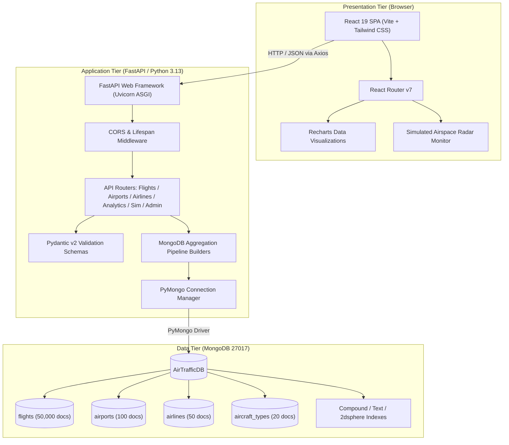
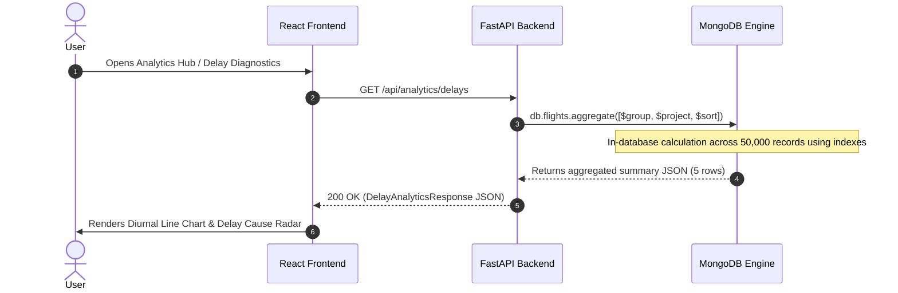

# AirTrack — System Architecture

## 1. Architectural Overview
AirTrack utilizes a 3-tier decoupled client-server architecture designed for high throughput, modularity, and rapid analytical aggregation:

1. **Presentation Layer (Frontend)**: React 19 + TypeScript + Vite + Tailwind CSS + Recharts + Lucide Icons.
2. **Application & Processing Layer (Backend)**: FastAPI (ASGI) + Uvicorn + Pydantic v2 + PyMongo.
3. **Database Layer (Storage & Aggregation Engine)**: MongoDB Community Server (`AirTrafficDB`) hosting 4 structured/semi-structured collections with custom indexes.

---

## 2. High-Level Architecture Diagram

---

## 3. Component Breakdown

### 3.1 Frontend Architecture
- **Vite Bundler**: Provides hot module replacement (HMR) and optimized Rolldown production bundles.
- **Tailwind CSS (Aviation Dark Theme)**: Custom color palette (`aviation-950`, `aviation-900`, `sky`, `radar`, `warning`) engineered for high-contrast flight status displays.
- **Responsive Table Design**: Conforms to the `modern-web-guidance` responsive table pattern utilizing `@container` queries, accessible `role="region"` semantics, and sticky `<thead>` headers for 50,000 document pagination.
- **Data Flow**: Axios HTTP client (`src/services/api.ts`) communicates with `/api` endpoints with centralized error handling.

### 3.2 Backend Service Architecture
- **FastAPI**: Asynchronous Python ASGI framework providing auto-generated OpenAPI 3.0 documentation (`/docs`) and high request throughput.
- **Lifespan Manager**: Establishes MongoDB connection pool upon startup, pings the server, ensures all single, text, and compound indexes exist, and safely closes the connection pool upon shutdown.
- **Data Serialization**: Handles BSON `ObjectId` conversions seamlessly to JSON string `id` attributes.

### 3.3 Database Tier & Engine
- **MongoDB Community Server**: Running as a local service on port `27017`.
- **Database**: `AirTrafficDB`.
- **In-Database Aggregations**: All analytics calculations (KPIs, diurnal delay curves, route rankings) are performed directly inside MongoDB using native C++ aggregation operators rather than pulling 50,000 documents into Python memory.

---

## 4. End-to-End Request/Response Cycle

